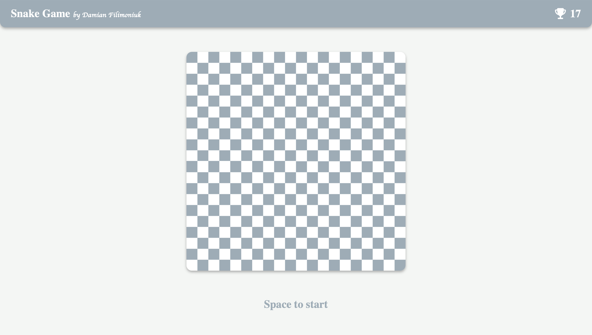
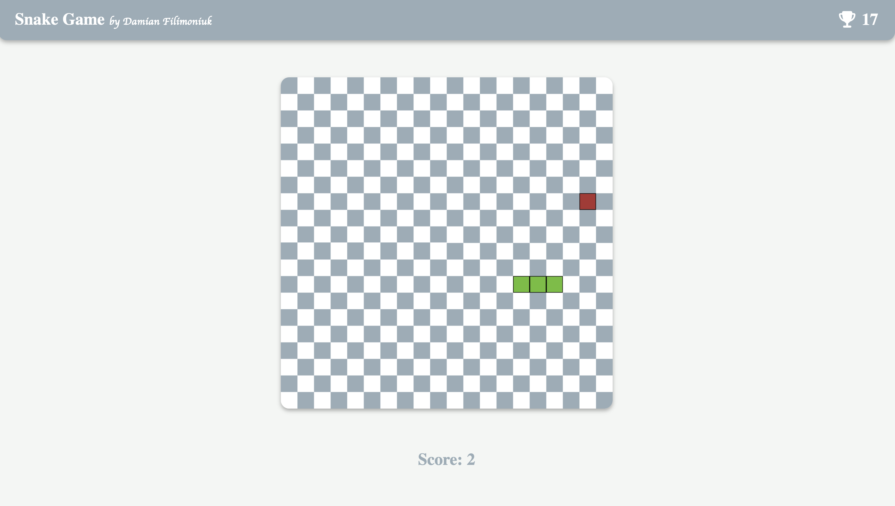

# Snake Game

A classic Snake game made in plain JavaScript, HTML, and CSS using HTML5 Canvas.




## Live Demo
[Play the game here](https://damianfilimoniuk.github.io/Classic-Snake-Game/)

## Features
- Snake movement with WASD and Arrow keys
- Anti-180° turn prevention to avoid accidental self-collision
- Persistent high score saved in the browser (`localStorage`)
- Custom pixel-art graphics
- Wall and self-collision detection

## Controls
- **Space** – Start / Restart game
- **W / A / S / D** or **Arrow Keys** – Move the snake

## Technologies Used
- HTML5 (Canvas)
- CSS3
- Vanilla JavaScript
- Font Awesome
- Web Storage API (`localStorage`)

## How to Run Locally
1. Clone the repository:
   ```bash
   git clone https://github.com/damianfilimoniuk/Classic-Snake-Game.git
   ```
2. Open the project folder and launch `index.html` in your browser.

## Author
Created by **Damian Filimoniuk**

## License
This project is licensed under the MIT License.